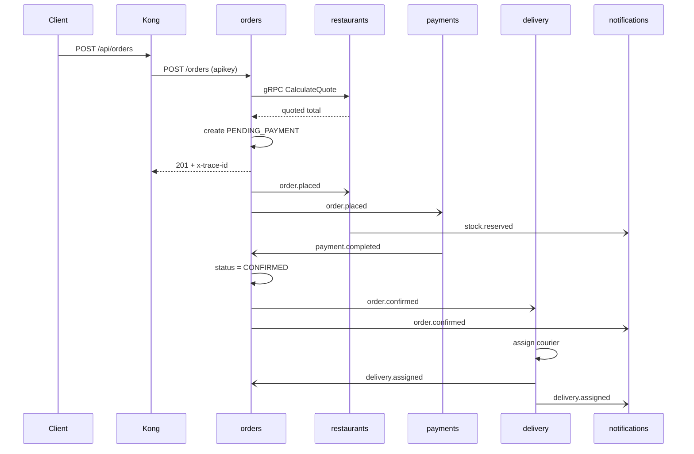
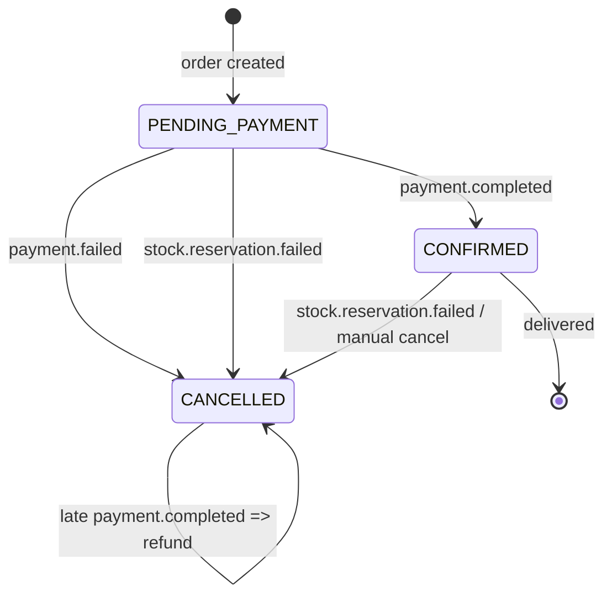

# Architecture

Rendered diagrams: [architecture](docs/images/be02-architecture.svg) · [saga compensation](docs/images/be02-saga.svg)

## System context

```mermaid
flowchart LR
  Client[Client / smoke script] -->|apikey + HTTP| Kong[Kong API Gateway]
  Kong --> Users[users]
  Kong --> Restaurants[restaurants]
  Kong --> Orders[orders]
  Kong --> Payments[payments]
  Kong --> Delivery[delivery]
  Kong --> Notifications[notifications]

  Orders -->|gRPC CalculateQuote| Restaurants

  Users --> DB1[(nexvia_users)]
  Restaurants --> DB2[(nexvia_restaurants)]
  Orders --> DB3[(nexvia_orders)]
  Payments --> DB4[(nexvia_payments)]
  Delivery --> DB5[(nexvia_delivery)]
  Notifications --> DB6[(nexvia_notifications)]

  Restaurants <-->|events| Rabbit[(RabbitMQ topic exchange)]
  Orders <-->|events| Rabbit
  Payments <-->|events| Rabbit
  Delivery <-->|events| Rabbit
  Notifications <--|events| Rabbit

  AllServices[All services] -->|Zipkin spans :9411| Jaeger[Jaeger :16686]
```

## Service boundaries

| Service | Responsibility | Owns | Never does |
| --- | --- | --- | --- |
| users | Registration, password hashing, login | users collection | Read order/payment data |
| restaurants | Restaurant catalog, menu, stock, gRPC quote | restaurants, menu_items, processed_reservations | Decide payment outcome |
| orders | Order lifecycle, saga orchestration, quote client | orders collection | Read another service's database |
| payments | Capture/refund simulation | payments collection | Mutate orders |
| delivery | Dispatch and courier status | deliveries collection | Mutate orders |
| notifications | Event log / in-app notifications | notifications collection | Publish commands |

Each service connects to the same MongoDB server but uses a distinct `dbName` (`nexvia_<service>`). Data is shared only through APIs and events.

## Event catalog

Exchange: `nexvia.events` (topic, durable). Routing keys use `<entity>.<action>`.

| Routing key | Producer | Consumers | Meaning |
| --- | --- | --- | --- |
| `order.placed` | orders | restaurants, payments, notifications | New order needs stock and payment |
| `stock.reserved` | restaurants | notifications | Stock decremented successfully |
| `stock.reservation.failed` | restaurants | orders, notifications | Insufficient stock; compensate |
| `payment.completed` | payments | orders, notifications | Capture succeeded |
| `payment.failed` | payments | orders, notifications | Capture declined; cancel order |
| `order.confirmed` | orders | delivery, notifications | Start dispatch |
| `order.cancelled` | orders | restaurants, notifications | Release reserved stock |
| `payment.refund.requested` | orders, payments API | payments | Compensating transaction |
| `payment.refunded` | payments | notifications | Refund completed |
| `delivery.requested` | delivery | notifications | Dispatcher notified |
| `delivery.assigned` | delivery | orders, notifications | Courier + ETA available |
| `delivery.status.updated` | delivery | notifications | Picked up / delivered |

## Happy-path choreography



## Saga compensation

The saga is choreographed but the order document is the state machine. Transitions are pure functions in `libs/shared/src/saga.ts` and are unit-tested.



Compensation rules:

- `payment.failed` on a pending order → cancel order → publish `order.cancelled` so restaurants release stock.
- `stock.reservation.failed` → cancel order → publish `order.cancelled` and `payment.refund.requested`.
- A late `payment.completed` on an already-cancelled order does **not** confirm it; it emits a refund request instead.
- Event deduplication uses `eventId` in `processedEvents` on order/payment/delivery documents and a unique index in notifications. Stock reservations use a `processed_reservations` collection.

## Fast service-to-service call

`proto/pricing.proto` defines `PricingService.CalculateQuote`. Restaurants hosts the gRPC server on port 50051; orders is the client. The quote returns line items, subtotal, delivery fee, tax, and total. The same pricing function is used when reserving stock, so the quoted price and reserved items cannot drift.

## Trace propagation

```text
HTTP traceparent ──> orders HTTP middleware
   ├─> gRPC metadata field (orders -> restaurants)
   └─> AMQP headers (order.placed)
         ├─> restaurants ──> stock.reserved
         ├─> payments ──> payment.completed ──> orders ──> order.confirmed
         │                                      └─> delivery ──> delivery.assigned
         └─> notifications
```

Every hop starts a child span with the same 32-hex trace id and the previous span as parent. Spans are POSTed to Jaeger's Zipkin-compatible endpoint (`http://jaeger:9411/api/v2/spans`) and also printed as JSON, so a single request can be demonstrated without extra infrastructure.

## Reliability notes

- RabbitMQ connections retry up to 30 times with 2-second backoff, so service startup order is not critical.
- Exchanges and queues are durable; messages are persistent and manually acknowledged.
- `prefetch(10)` bounds consumer work; failed handlers are nacked without requeue and logged.
- Saga updates use a conditional `updateOne` on the expected status plus `$addToSet` of the event id, preventing double transitions under redelivery.

## Kubernetes next steps

Replace Compose with per-service Deployments/Services, externalize MongoDB/RabbitMQ via operators or managed services, mount Kong config as a ConfigMap, add HorizontalPodAutoscalers for orders/payments, and switch the Zipkin exporter to the OpenTelemetryCollector for production-grade traces.
