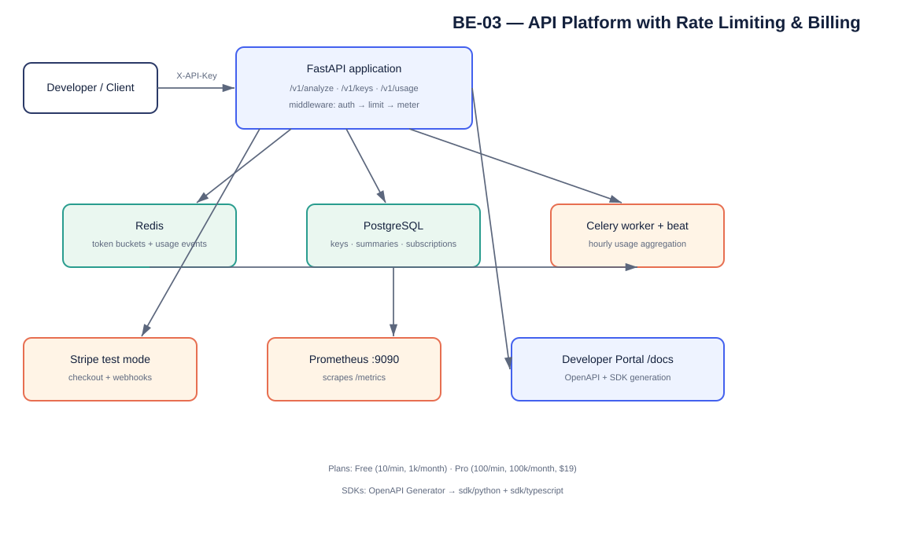
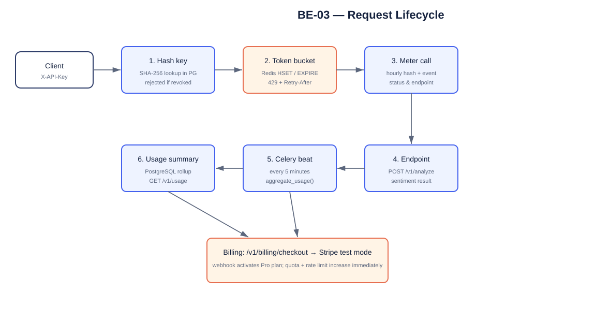
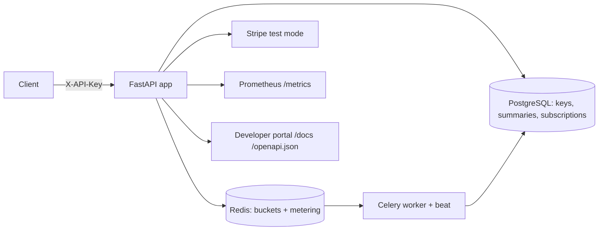

# BE-03 — API Platform with Rate Limiting, Billing, and Developer Portal

An "API as a product" backend: developers create hashed API keys, calls are metered and limited with Redis, usage is aggregated by Celery into PostgreSQL, Stripe test-mode checkout upgrades plans, and everything is discoverable through an OpenAPI-powered developer portal and Prometheus metrics.

> This project lives in `D:\Nexvia\BE-03`. The sibling `BE-02` folder contains the food-delivery microservices backend.

## Diagrams





## Feature breakdown

| Milestone | Implementation |
| --- | --- |
| 1. Useful sample API | `POST /v1/analyze` — lexicon sentiment analysis with score, word/sentence counts and keywords. No external dataset required. |
| 2. API keys | `POST /v1/keys` generates `nex_test_…` keys, stores only SHA-256 hashes + 12-char prefixes, and supports revocation. Raw key is returned once. |
| 3. Redis rate limiting | Per-key token bucket in `app/rate_limit.py`; `429` with `Retry-After` and `X-RateLimit-*` headers. Free = 10/min, Pro = 100/min. |
| 4. Metering + aggregation | Middleware writes hourly Redis counters and a capped event list. Celery beat runs `aggregate_usage` every 5 minutes into `usage_summaries`. |
| 5. Plans + Stripe billing | Free/Pro plan definitions, simulated Stripe test checkout when no key is configured, real Stripe Checkout when `STRIPE_SECRET_KEY` is set, signed webhooks, idempotent plan upgrades. |
| 6. Webhooks + SDKs | `POST /webhooks/stripe`, a demo webhook helper, and OpenAPI Generator scripts for Python and TypeScript clients. |
| 7. Metrics + portal | Prometheus counters/histograms at `/metrics`, Swagger UI, ReDoc, OpenAPI JSON, and a custom interactive portal at `/portal`. |

## Architecture



Request middleware order for `/v1/*` (except admin key management):

```text
X-API-Key → SHA-256 lookup → revoked check → Redis token bucket
          → meter call (including 429s) → endpoint → meter result → Prometheus
```

A late note: the Redis read/modify/write bucket is intentionally simple for demo clarity; replace it with the Lua equivalent for strict atomicity under high concurrency.

## Tech stack

FastAPI · SQLAlchemy 2 · PostgreSQL 16 · Redis 7 · Celery · Stripe (test mode) · OpenAPI Generator · Prometheus · Pytest

## Installation and run

### Docker Compose (recommended)

```bash
cd D:\Nexvia\BE-03
docker compose up -d --build
docker compose ps
python scripts/smoke.py        # or: .venv\Scripts\python.exe scripts/smoke.py
```

Services:

| Service | URL | Purpose |
| --- | --- | --- |
| API | http://localhost:8000 | REST API and portal |
| Swagger UI | http://localhost:8000/docs | Interactive API docs |
| Portal | http://localhost:8000/portal | Developer portal |
| Prometheus | http://localhost:9090 | Scrapes `/metrics` every 10s |
| PostgreSQL | localhost:5432 | `postgres` / `postgres`, DB `nexvia_api` |
| Redis | localhost:6379 | Buckets and metering |

### Local Python environment (without Docker)

Copy `.env.example` to `.env`, point `DATABASE_URL`/`REDIS_URL` at local instances (or use `sqlite:///:memory:` and `REDIS_URL=memory://` for tests), then:

```bash
python -m venv .venv
.venv\Scripts\python.exe -m pip install -r requirements.txt
.venv\Scripts\python.exe -m uvicorn app.main:app --reload
.venv\Scripts\python.exe -m celery -A app.tasks:celery_app worker --loglevel=info
.venv\Scripts\python.exe -m celery -A app.tasks:celery_app beat --loglevel=info
```

## Quickstart API calls

Create a key (admin token from `ADMIN_TOKEN`):

```bash
curl -X POST http://localhost:8000/v1/keys \
  -H 'X-Admin-Token: admin-demo-token' \
  -H 'Content-Type: application/json' \
  -d '{"owner":"alice","plan":"free"}'
```

Call the sample API with the returned key:

```bash
curl -X POST http://localhost:8000/v1/analyze \
  -H 'X-API-Key: nex_test_YOUR_KEY' \
  -H 'Content-Type: application/json' \
  -d '{"text":"The food was delicious and fresh!"}'
```

Other endpoints: `GET /v1/usage`, `GET /v1/plans`, `POST /v1/billing/checkout`, `POST /webhooks/demo/checkout?key_id=…`, `POST /v1/keys/{id}/revoke`.

## Tests

```bash
.venv\Scripts\python.exe -m pytest -q
```

8 tests cover key hashing/revocation, invalid/missing keys, Redis token-bucket rejection, per-call metering, sentiment output, Stripe checkout + webhook idempotency, Celery aggregation, and portal/metrics/OpenAPI exposure. Tests use SQLite + fakeredis, so no infrastructure is required.

## Client SDK generation

```bash
# Linux/macOS
./scripts/generate_sdk.sh

# Windows PowerShell
./scripts/generate_sdk.ps1
```

Requires Docker or the `openapitools/openapi-generator-cli` image. Outputs `sdk/python` and `sdk/typescript` from `http://localhost:8000/openapi.json`.

## Repository layout

```
app/
  main.py              app factory, middleware, portal, metrics
  config.py            settings + plan catalogue
  db.py / models.py    SQLAlchemy engine, sessions, tables
  auth.py              key generation/hashing/admin guard
  rate_limit.py        Redis token bucket
  metering.py          hourly counters + usage events
  billing.py           Stripe checkout + webhook handling
  analyzer.py          sample sentiment engine
  metrics.py           Prometheus collectors
  portal.py            developer portal HTML
  routers/             keys, analyze, usage, billing, webhooks
  tasks.py             Celery app + aggregation task
tests/                 pytest suite with SQLite + fakeredis
scripts/               smoke test and SDK generators
docs/images/           generated architecture diagrams
```

## Notes and limitations

- Stripe runs in simulated mode unless `STRIPE_SECRET_KEY` is provided; no real charges occur.
- Key management uses a shared `ADMIN_TOKEN`; a production portal should use SSO and per-tenant roles.
- The sample sentiment engine is a transparent lexicon, not an ML model; swap it for IMDB/Sentiment140-trained inference if desired.
- Generated SDK folders are gitignored because they are build artifacts.

## Cleanup

```bash
docker compose down -v
```
