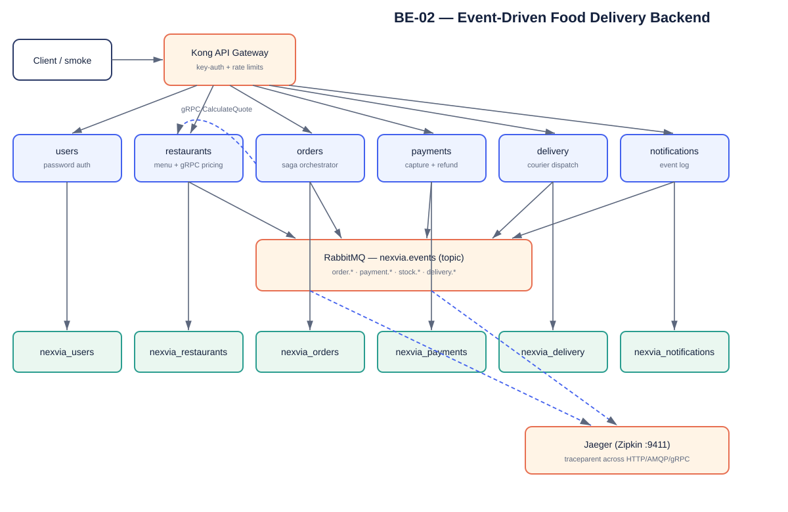
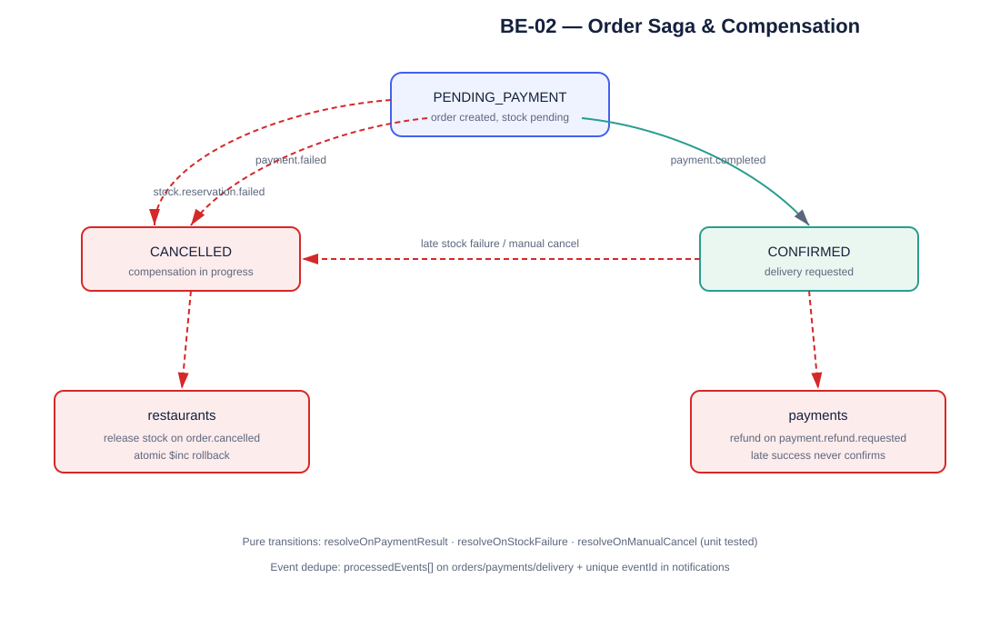
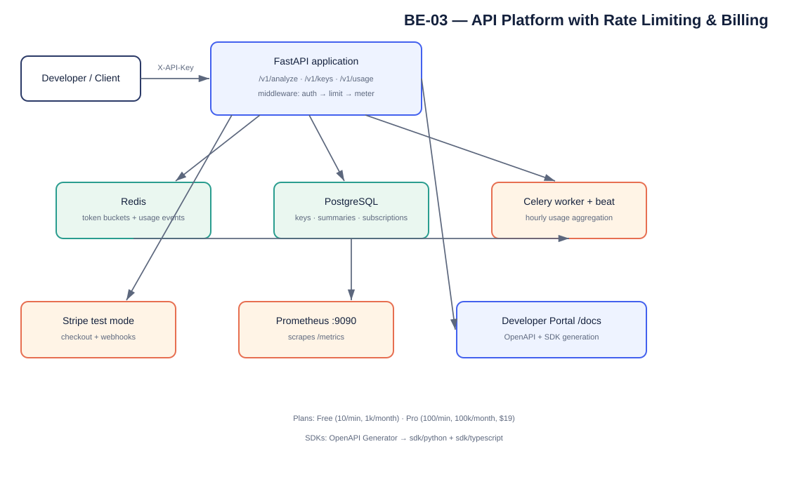
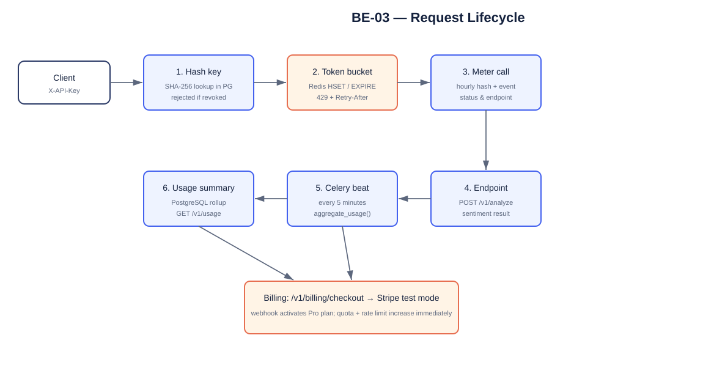

# Nexvia Backend Portfolio — BE-02 & BE-03

This repository contains two independently runnable backend projects for the Backend Development specialization track.

| Folder | Project | Stack | Core idea |
| --- | --- | --- | --- |
| [`BE-02/`](BE-02) | Microservices-Based Food Delivery Backend | NestJS, RabbitMQ, gRPC, Kong, MongoDB, Jaeger, Docker Compose | Six event-driven services with a compensating order saga |
| [`BE-03/`](BE-03) | API Platform with Rate Limiting, Billing, and Developer Portal | FastAPI, Redis, PostgreSQL, Celery, Stripe, OpenAPI Generator, Prometheus | An API sold as a product: keys, quotas, metering, billing, docs |

Each project has its own source, tests, diagrams, configuration and README. They are separate runtimes; start only the one you are demoing.

---

## 1. Repository structure

```text
D:\Nexvia
├── README.md                 ← this file
├── BE-02/
│   ├── README.md             ← architecture, install/run, features
│   ├── ARCHITECTURE.md       ← service boundaries, saga, tracing
│   ├── API.md                ← HTTP, event and gRPC reference
│   ├── docker-compose.yml
│   ├── docker/Dockerfile
│   ├── infra/kong/kong.yaml
│   ├── proto/pricing.proto
│   ├── libs/shared/          ← events, saga, Rabbit client, tracing
│   ├── services/             ← users, restaurants, orders, payments, delivery, notifications
│   ├── scripts/smoke.mjs
│   ├── docs/
│   │   ├── TEST_RESULTS.md
│   │   └── images/*.svg      ← generated architecture diagrams
│   └── package.json
└── BE-03/
    ├── README.md             ← architecture, install/run, features
    ├── docker-compose.yml
    ├── Dockerfile
    ├── requirements.txt
    ├── prometheus.yml
    ├── app/                  ← FastAPI app, middleware, routers, Celery task
    ├── tests/                ← pytest suite (SQLite + fakeredis)
    ├── scripts/              ← smoke test + SDK generators
    ├── sdk/README.md
    └── docs/images/*.svg     ← generated architecture diagrams
```

Screenshots are represented by committed, generated SVG architecture/flow diagrams in each project's `docs/images/` folder. Live UI captures (Jaeger, Kong, Swagger, Prometheus) should be added after running the stacks; the smoke scripts print the exact views to capture.

---

## 2. Architecture overview

### BE-02 — Food delivery microservices



- **Gateway:** Kong routes `/api/*` to six NestJS services, enforces `apikey` auth and per-consumer rate limits.
- **Data isolation:** one MongoDB database per service (`nexvia_users`, `nexvia_restaurants`, …). No cross-service database reads.
- **Async collaboration:** RabbitMQ topic exchange `nexvia.events` carries `order.placed`, `payment.completed`, `order.confirmed`, `order.cancelled`, stock and delivery events.
- **Sync collaboration:** gRPC `PricingService.CalculateQuote` lets orders get a fast quote from restaurants.
- **Saga:** orders is the state machine. Payment failure cancels the order and releases stock; stock failure cancels and refunds; late payments never confirm a cancelled order.
- **Tracing:** W3C `traceparent` flows through HTTP headers, AMQP properties and a gRPC request field into Jaeger via its Zipkin endpoint.



Full details: [BE-02/ARCHITECTURE.md](BE-02/ARCHITECTURE.md) and [BE-02/API.md](BE-02/API.md).

### BE-03 — API platform



- **Auth:** generated `nex_test_` keys are stored as SHA-256 hashes; revocation takes effect on the next request.
- **Rate limiting:** Redis token bucket per key; `429` responses include `Retry-After` and `X-RateLimit-*`.
- **Metering:** middleware records every call in hourly Redis counters; Celery beat aggregates into PostgreSQL every 5 minutes.
- **Billing:** Free and Pro plans; Stripe test checkout and signed webhooks upgrade plans without real charges.
- **Developer experience:** Swagger UI, ReDoc, OpenAPI JSON, a custom portal, generated Python/TypeScript SDKs, and Prometheus metrics.



Full details: [BE-03/README.md](BE-03/README.md).

---

## 3. Installation and run

### Prerequisites

- **Docker Desktop / Docker Engine + Compose v2** for full stacks.
- **Node.js 20+** and npm for BE-02 tests/builds.
- **Python 3.12+** for BE-03 tests/local runs.

### Start BE-02

```bash
cd D:\Nexvia\BE-02
npm install
npm run build
npm test                       # 9 unit tests
docker compose up -d --build
npm run smoke                  # order saga demo through Kong
```

Key URLs: API `http://localhost:8000/api` (header `apikey: demo-key-user`), Jaeger `:16686`, RabbitMQ UI `:15672`, Kong Admin `:8001`.

### Start BE-03

```bash
cd D:\Nexvia\BE-03
python -m venv .venv
.venv\Scripts\python.exe -m pip install -r requirements.txt
.venv\Scripts\python.exe -m pytest -q       # 8 tests, no infra needed
docker compose up -d --build
.venv\Scripts\python.exe scripts/smoke.py
```

Key URLs: API `http://localhost:8000`, Portal `/portal`, Swagger `/docs`, Prometheus `:9090`. Create keys with header `X-Admin-Token: admin-demo-token`.

> Run the projects one at a time: both use host port 8000. Stop one stack with `docker compose down -v` before starting the other.

---

## 4. Feature and evaluation map

| Requirement | BE-02 evidence | BE-03 evidence |
| --- | --- | --- |
| Service boundaries + own DB | 6 NestJS services, 6 Mongo DB names | FastAPI app with 3 SQLAlchemy tables |
| Gateway auth + rate limits | Kong key-auth + per-service plugins | Redis token bucket + admin-token key management |
| Events | 12 RabbitMQ routing keys | Redis usage events + Stripe webhooks |
| Saga / compensation | Unit-tested state machine + smoke scenarios | Webhook idempotency + refund plan downgrade |
| Fast service-to-service call | gRPC pricing | — |
| Tracing | Jaeger + propagated `traceparent` | Prometheus counters + histograms |
| Developer portal / docs | `API.md`, OpenAPI-style endpoint tables | Swagger, ReDoc, custom portal, SDK generation |
| Tests | 9 passing unit tests + E2E smoke | 8 passing pytest tests + E2E smoke |
| Diagrams / screenshots | `docs/images/*.svg` | `docs/images/*.svg` |

---

## 5. Known simplifications

- BE-02 uses one MongoDB container with six logical databases; production should isolate clusters/credentials.
- BE-02 payments and courier assignment are simulated; the custom tracer is Zipkin-compatible rather than full OpenTelemetry.
- BE-03 Stripe is simulated unless `STRIPE_SECRET_KEY` is set, and admin access uses a shared token.
- Docker was unavailable in the environment where these files were generated, so container startup and HTTP smoke scripts were not executed here; unit tests, builds, proto loading and YAML parsing were executed successfully. See `BE-02/docs/TEST_RESULTS.md`.

## 6. Git

Clean modular commits are used. The repository was initialized with the BE-02 scaffold commit, followed by the restructure and BE-03 implementation commits.
